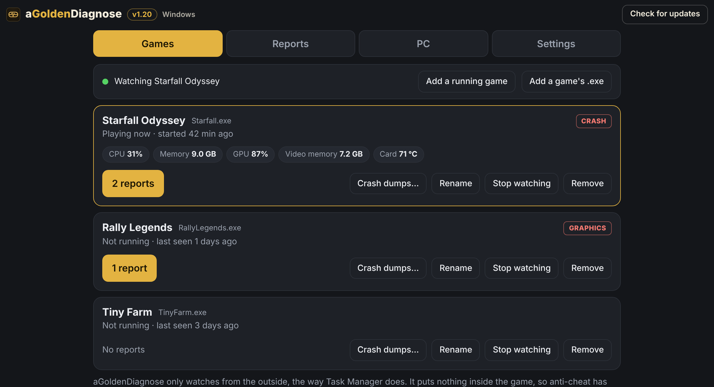
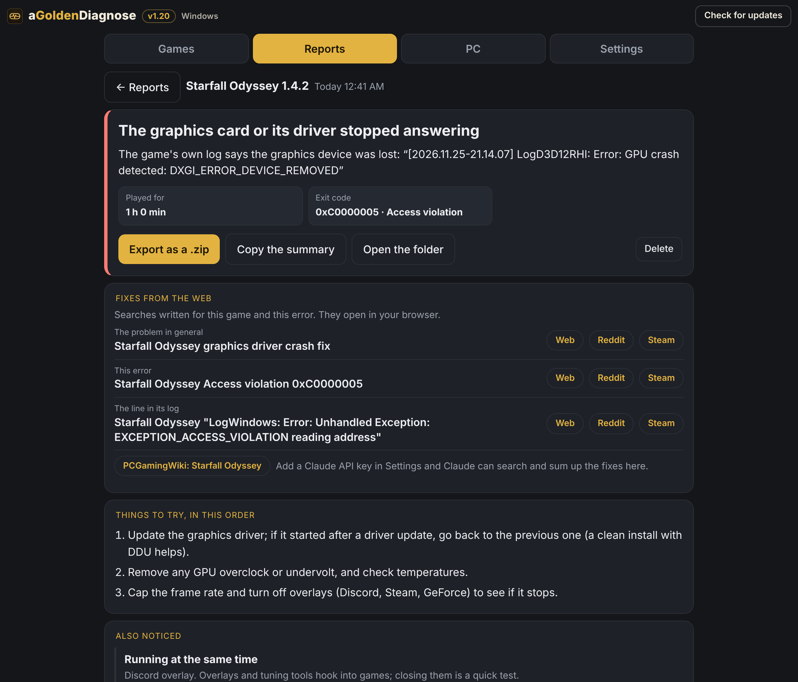
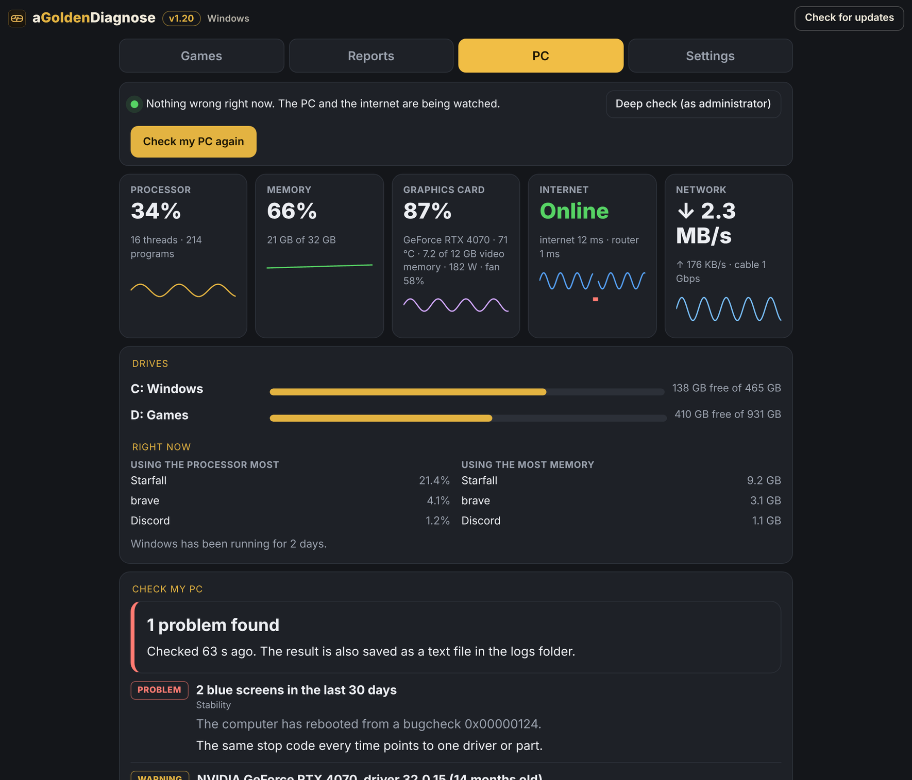
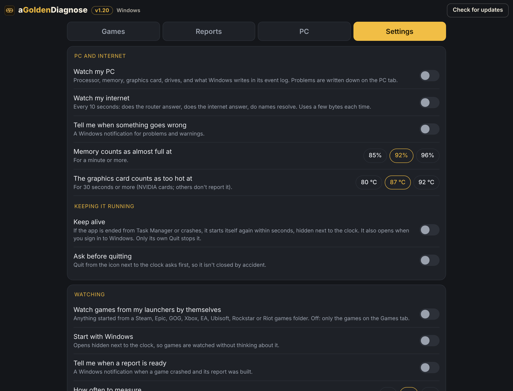
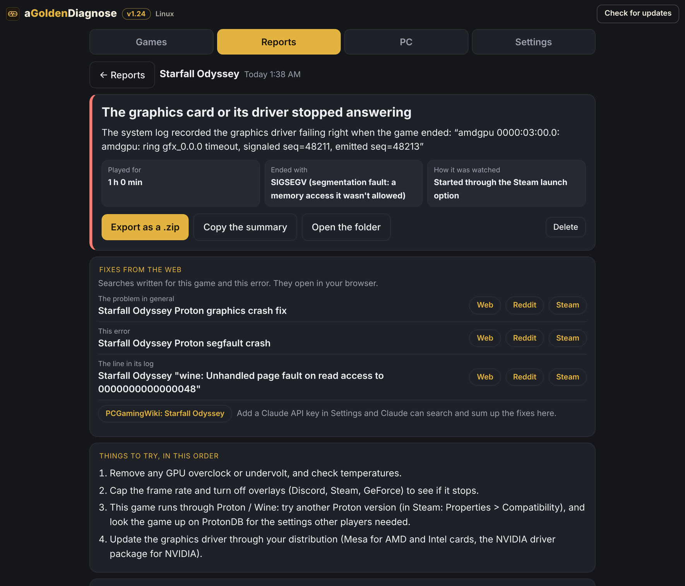

# aGoldenDiagnose

An app for Windows and Linux that watches your games and your PC, and gathers everything about a crash into one report you can read.

It is free and open source: the code in this repository is exactly what the downloads are built from, so anyone can check what it does before running it.

## Preview

| Your games | A crash report |
|---|---|
| [](screenshots/games.png) | [](screenshots/report.png) |
| **PC and internet** | **Settings (everything starts off)** |
| [](screenshots/pc.png) | [](screenshots/settings.png) |

**On Linux** (a Proton game started through the Steam launch option):

[](screenshots/linux.png)

The games and the PCs in these pictures are made up for the example.

## What it does

- **Game crashes.** You pick the games to watch. When one of them closes by itself, freezes or exits with an error, the app collects that game's log files and crash dumps and what the system wrote down at that moment into a report, with the likely cause at the top. Reports can be exported as a .zip to send to someone who can help.
- **PC and internet monitor.** Processor, memory, graphics card, drives and connection, shown live. When something goes wrong (memory almost full, graphics card too hot, connection dropping) it is written down with the time.
- **Health check.** A look at the usual causes of trouble: errors in the system's log, free space, drivers, memory.
- **Patterns.** The Reports tab also looks at the reports together: the same game failing again and again, the same driver file in the crashes of different games, or several games failing within minutes of each other (which points to the PC, not the games).
- **Fixes from the web.** A report has buttons that search the web for that game and that error.
- **Sharing a report.** Export it as a .zip; you can choose to have your user name and your PC's name replaced with stars in every file of the .zip first (the report kept on your PC isn't changed).
- **Asking for help on Discord.** **Copy for Discord** puts a short version of the report on the clipboard (with your user and PC names hidden), ready to paste.
- **Quick fixes on a report.** **Verify the game's files** asks Steam to check a Steam game's files; **Clear shader caches…** clears the graphics drivers' shader caches and the game's Steam one after showing you their sizes (they're rebuilt by themselves).
- **Driver changes.** The Reports tab points out when problems started after the graphics driver or the system was updated.

## Download and run

Everything starts **switched off** on both systems. Open **Settings** and turn on what you want.

**Windows 10 and 11 (64-bit)**

1. Get **aGoldenDiagnose.exe** from the [latest release](../../releases/latest).
2. Run it. There is nothing to install: it is a single file.

Windows may show "Windows protected your PC" the first time, because the file has no paid signature. Choose **More info → Run anyway**.

**Linux (64-bit)**

1. Get **aGoldenDiagnose.AppImage** from the [latest release](../../releases/latest).
2. Make it runnable and start it: right-click it → Properties → "Allow executing file as program", or in a terminal `chmod +x aGoldenDiagnose.AppImage` then `./aGoldenDiagnose.AppImage`. There is nothing to install.

If it doesn't start, your system may be missing FUSE 2, which AppImages use (on Ubuntu 22.04 and newer: `sudo apt install libfuse2`, or `libfuse2t64` on 24.04). It never asks for administrator rights itself.

## What it touches on your PC

**Windows**

| | |
|---|---|
| **Reads** | The list of running programs (to notice a watched game starting and closing), the log and crash-dump files in the folders of the games you watch, the Windows event log, and hardware readings (processor, memory, graphics card, drives, network adapters). |
| **Writes** | Its reports and logs in `Documents\aGoldenDiagnose`, its settings in `%APPDATA%\aGoldenDiagnose`, and a report you export as a .zip in `Downloads\aGoldenDiagnose`. When you press **Update**, it downloads the new version and replaces its own .exe with it. Nothing else. |
| **Changes to Windows** | None, unless you turn on **Start with Windows** or **Keep alive**, which add the app to the programs that start when you sign in (the normal Windows way, no scheduled task or service). Turning them off removes it again. With **Keep alive** on, the app and its small helper also start each other again if one of them is ended. The **Crash dumps…** button on a game, if you use it, asks Windows (once, with an administrator prompt) to keep a small crash dump for that one game; pressing it again turns that off. |
| **Administrator rights** | Not needed. Only the optional **Deep check (as administrator)** and **Crash dumps…** buttons ask for them, once each time, and only when you press them. |
| **Game files** | Never changed. It only reads logs and crash dumps. It doesn't touch a game's memory or its anti-cheat. **Verify the game's files** only asks Steam to check them (Steam does the checking). |
| **Shader caches** | Only when you press **Clear shader caches…** on a report and confirm: it empties the graphics drivers' shader caches in `%LOCALAPPDATA%` (NVIDIA, AMD, Intel, DirectX) and `C:\ProgramData\NVIDIA Corporation\NV_Cache`, and the game's Steam shader cache. |

**Linux**

| | |
|---|---|
| **Reads** | What Linux publishes about running programs in `/proc` (the same place `top` reads), the log and crash files of the games you watch (for games run through Proton or Wine, inside that game's own prefix), the system log through `journalctl` (crashes, the graphics driver, out-of-memory, hardware and drive errors), and hardware readings from `/sys`, `df` and, on NVIDIA cards, `nvidia-smi`. |
| **Writes** | Its reports and logs in `~/Documents/aGoldenDiagnose`, its settings in `~/.config/aGoldenDiagnose`, and a report you export as a .zip in `~/Downloads/aGoldenDiagnose`. When you press **Update**, it downloads the new AppImage and puts it in place of the old one. If you use the Steam launch option (below): the script `~/.local/share/aGoldenDiagnose/agd-run.sh`, and a few small files per game run in `~/.local/share/aGoldenDiagnose/runs`, deleted once the report is made (or after 7 days). Nothing else. |
| **Changes to the system** | None, unless you turn on **Start when I sign in** or **Keep alive**, which put one small file, `~/.config/autostart/aGoldenDiagnose.desktop`, in your own autostart folder, or **Show in the applications menu**, which puts one in `~/.local/share/applications`. Turning them off deletes them. With **Keep alive** on, its helper starts the app again if the app is ended. |
| **Administrator rights** | Never needed. Only the optional **Deep check (asks for your password)** button, when you press it, runs `smartctl` through your system's password prompt (`pkexec`) to read each drive's own health. It only reads. |
| **Game files** | Never changed. It doesn't attach to games (no ptrace), doesn't read their memory and doesn't touch their anti-cheat. **Verify the game's files** only asks Steam to check them. |
| **Shader caches** | Only when you press **Clear shader caches…** on a report and confirm: it empties `~/.cache/nvidia/GLCache`, `~/.cache/mesa_shader_cache` and the game's Steam shader cache. |

Linux doesn't let an outside program see how a game ended, or whether its window stopped answering. By itself the app recognises a crash from what it leaves behind: a core dump recorded by systemd, a crash report in `/var/crash` (Ubuntu, Mint), a line in the system log, the game's own crash files and log. The Windows-only **Crash dumps…** button isn't shown.

### The Steam launch option (Linux, optional)

For the full picture, start a game through a small script: **Settings → Linux → Copy the launch option**, then in Steam paste it into the game's **Properties → General → Launch options**. It looks like `"/home/you/.local/share/aGoldenDiagnose/agd-run.sh" %command%`.

- The report then has the game's **real exit code** (or the signal that ended it, like a segmentation fault) and **everything the game printed** while it ran, which often says what went wrong.
- Games started this way are watched even when **Watch games from my launchers by themselves** is off.
- If aGoldenDiagnose was closed while the game ran, the report is made the next time it opens.
- Optional: **Proton's own log** (off until you turn it on) asks Proton to write its detailed log for those runs, and adds it to the report. It can slow a game down and grow large.
- The script is a plain text file you can read: it starts the game exactly as Steam asked, notes when it started and ended and its exit code, and saves what the game printed. It starts nothing else and sends nothing anywhere. To stop using it, delete the launch option in Steam.

## What it sends over the internet

By itself: nothing. There is no account, no tracking and no "phone home".

It goes online only for these, and only when the matching feature is used:

- **Check for updates** asks this repository's Releases page for the newest version, and **Update** downloads it from there (GitHub sees your IP address, like for any download). It never updates by itself.
- **Watch my internet** (off by default) pings your router, `1.1.1.1` and `8.8.8.8` and looks up `example.com`, to tell whether your connection works.
- **The search buttons** in a report open a web search in your browser.
- **Explain with Claude** (optional, only if you enter your own Anthropic API key) sends the text of that one report to `api.anthropic.com`.
- **Explain with a local AI model** (optional, off by default) sends that one report's text only to an AI model running on your own PC (Ollama, at `127.0.0.1`): nothing leaves the PC.

## Checking it yourself

Nothing here is hidden or scrambled: the files in the downloads are these files, as they are. You can open the .exe with 7-Zip, or run the AppImage with `--appimage-extract`, and compare.

- **The code** is in `desktop/` (the app itself), `web/` (the screens), `desktop/helper/AgdHelper.cs` (the small Windows helper that reads the process list, the event log and the hardware) and `desktop/linux-helper.js` (the same helper for Linux).
- **The downloads are built here, in the open.** Each release is made by GitHub's own machines from the code in this repository: see the **Actions** tab. The release notes give the SHA-256 of each file and a link to the run that built it.
- **Each download carries a signed attestation.** GitHub signs a record saying exactly which build run, from which commit of this repository, made each file. With the [GitHub command-line tool](https://cli.github.com) you can check a download yourself:

  ```
  gh attestation verify aGoldenDiagnose.exe -R SirGoldenTaco/agoldendiagnose-app
  ```

  (or `aGoldenDiagnose.AppImage`). If the file was changed in any way after it was built here, the check fails.
- **Virus scans:** when the release notes list VirusTotal links, both files were sent there right after they were built, and the links show what about 70 antivirus engines think of them.
- **No log server, no hidden upload.** The app's own log stays on your PC. The only places it connects to are listed above, under "What it sends over the internet".
- **Build it yourself on Windows,** with Node.js 22 and the .NET Framework compiler:

  ```
  cd desktop
  csc /optimize /platform:x64 /out:native\agd-helper.exe /r:System.Web.Extensions.dll /r:System.IO.Compression.dll /r:System.IO.Compression.FileSystem.dll /r:System.Xml.dll helper\AgdHelper.cs
  xcopy /E /I ..\web web
  echo {"token":""}> update-config.json
  npm install
  npm run dist
  ```

  The result is `desktop\dist\aGoldenDiagnose.exe`.
- **Build it yourself on Linux,** with Node.js 22:

  ```
  cd desktop
  cp -r ../web web
  echo '{"token":""}' > update-config.json
  mkdir -p native
  npm install
  npm run dist:linux
  ```

  The result is `desktop/dist/aGoldenDiagnose.AppImage`.

## Removing it

**Windows:** close it (right-click its icon next to the clock → Quit), delete `aGoldenDiagnose.exe`, and delete the folders above if you don't want to keep your reports and settings. If you had turned on **Start with Windows** or **Keep alive**, turn them off first.

**Linux:** turn off **Start when I sign in**, **Keep alive** and **Show in the applications menu** if you had turned them on, remove the launch option from your games in Steam if you used it, quit it from its tray icon, delete the AppImage, and delete the folders above (including `~/.local/share/aGoldenDiagnose`) if you don't want to keep your reports and settings.

## Notes

- Windows 10 and 11, 64-bit. Linux, 64-bit, with systemd (most distributions) for the system-log readings.
- Graphics-card temperature and power readings need an NVIDIA card on Windows; on Linux they also work on AMD cards. The rest works on any.
- Hiding your names when exporting replaces your user name, your home folder's name and your PC's name wherever they appear (names shorter than 3 letters are left alone, since they would match ordinary words). Other things a game writes in its own logs, like an in-game player name, stay as they are: look through the .zip before sending it if that matters to you.
- The tray icon on Linux needs a desktop that shows tray icons (KDE, Cinnamon, Xfce do; GNOME needs the AppIndicator extension).
- **Steam Deck:** use it in Desktop Mode. In Game Mode there's no tray and no window to switch to; the Steam launch option still records each run, and the report is made the next time you open the app in Desktop Mode.
- **Steam installed as a Flatpak:** Steam can't see the launch-option script until you allow it once: `flatpak override --user --filesystem=xdg-data/aGoldenDiagnose com.valvesoftware.Steam`.
- Graphics use per game: NVIDIA cards through `nvidia-smi`; AMD and Intel cards through the kernel's own per-program counters (no extra tool needed).
- This is a hobby project, provided as it is, with no warranty. It is not affiliated with any game, launcher or hardware maker.
- Found a problem? Open an issue on this repository (the form reminds you to keep personal details out of it). Found a security problem? Please report it privately, as [SECURITY.md](.github/SECURITY.md) explains.

## What changed

Every version and everything that changed in it is in the [changelog](CHANGELOG.md). Each release also lists the files that changed and links to the exact differences.

## Licence

MIT: see [LICENSE](LICENSE).
